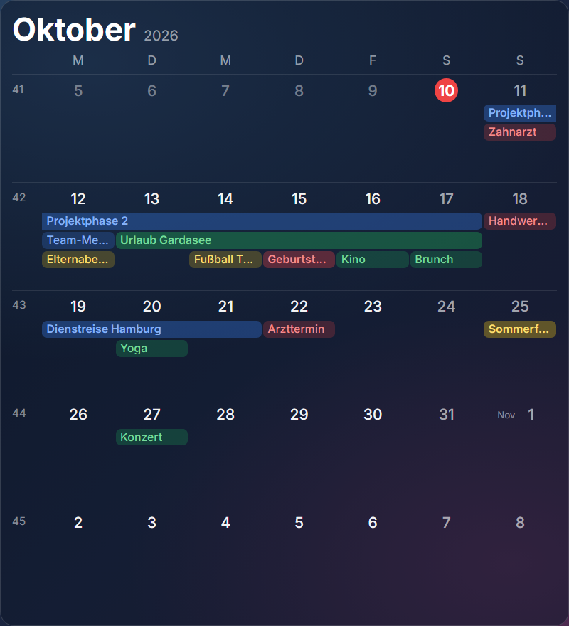

# Monatskalender · Month Calendar

**[Deutsch](#deutsch) · [English](#english)** · Plugin für / for [Home Screens](https://github.com/home-screens/home-screens) · v0.1.1

<p align="center"></p>

## Deutsch

Ein **Wochenraster im Stil der iOS-Kalender-App**: Mehrtägige Termine laufen als durchgehende Balken über mehrere Tage, Termine mit Uhrzeit sind kleine Chips, links stehen die Kalenderwochen.

### Was kann das Plugin?

- Durchgehende **Balken für mehrtägige Termine**, auch über Wochengrenzen
- Kleine Chips für Termine mit Uhrzeit, „+N“ wenn der Platz nicht reicht
- **Farben deiner Kalender** werden übernommen, heutiger Tag rot markiert
- Kalenderwochen, Monatskürzel am Monatsersten

### Installation – Schritt für Schritt

**Voraussetzung:** Du hast Home Screens bereits laufen (Server erreichbar im Browser).

1. Öffne den **Editor** deines Home-Screens-Servers im Browser an einem Computer (nicht am Handy; er braucht mindestens 768 Pixel Breite). Die Adresse ist meist `http://<Adresse-deines-Servers>:3000/editor`.
2. Klicke oben in der Leiste auf **Plugins** (neben „Einstellungen“ und „Vorschau“).
3. Klicke auf **Aus URL installieren …**.
4. Füge im Feld **Tarball-URL** diesen Link ein und klicke auf **Installieren**:

   ```
   https://github.com/Gyrosguenter/home-screens-plugin-calendar/releases/latest/download/calendar-month.tar.gz
   ```

   Home Screens weist darauf hin, dass das Plugin „nicht vom Home-Screens-Team geprüft“ ist. Das ist normal, denn es stammt nicht aus dem Marktplatz. Du siehst eine Übersicht, was das Plugin darf.
5. Warte, bis die Installation fertig ist, und klicke auf **Fertig**. Falls das Modul nicht sofort in der Liste auftaucht, lade die Seite neu (F5).
6. Ziehe das Modul auf den Bildschirm: Links in der Liste **MODULE** (Hinweis „Auf den Bildschirm ziehen“) findest du unter **ZEIT & DATUM** das Modul **Monatskalender** (mit der Markierung „Plug-in“). Ziehe es auf deinen Bildschirm und passe Größe und Position an.
7. Klicke das Modul an: rechts erscheinen die **Einstellungen**. Der Editor **speichert automatisch**, einen Speichern-Knopf gibt es nicht.

### Einstellungen

| Einstellung | Bedeutung |
|---|---|
| Wochen | Wie viele Wochen ab der aktuellen Woche gezeigt werden (2–6, Standard 5). |
| Termine je Tag | Zeilen für Termine pro Woche (1–8, Standard 4). Was nicht passt, erscheint als „+N“. |
| Kalenderwochen zeigen | Spalte mit den Kalenderwochen ein-/ausblenden. |
| Aktualisierung (ms) | Wie oft Termine neu geladen werden (Standard 5 Minuten). |

### Aktualisieren

Wiederhole einfach die Installation mit **demselben Link** (Schritte 2–4). Er zeigt immer auf die neueste Version; deine Einstellungen bleiben erhalten.

### Hilfe bei Problemen

- **Keine Termine zu sehen?** Das Modul zeigt die Kalender, die du in Home Screens unter **Einstellungen → Kalender** verbunden hast (iCal-Links, Google, iCloud …). Ohne verbundenen Kalender bleibt es leer.
- **Farben ändern:** In denselben Kalender-Einstellungen die Farbe je Kalender setzen.
- **Installation schlägt fehl?** Dein Home-Screens-Server muss auf `github.com` zugreifen können (Internet). Prüfe, ob der Link vollständig kopiert wurde.
- **Modul bleibt leer nach dem Ziehen?** Seite neu laden (F5). Ein paar Sekunden warten, manche Module laden Daten erst nach dem Einfügen.

### Datenschutz und Hinweise

Das Modul liest die Termine ausschließlich von deinem eigenen Home-Screens-Server (`/api/calendar`, interne Schnittstelle von Home Screens). Es sendet nichts ins Internet. **Hinweis:** Weil die Schnittstelle intern und nicht dokumentiert ist, kann ein Home-Screens-Update sie ändern.

---

## English

A **week grid in the style of the iOS Calendar app**: multi-day events run as continuous bars across days, timed events are small chips, calendar weeks are listed on the left.

### What does it do?

- Continuous **bars for multi-day events**, also across week boundaries
- Small chips for timed events, "+N" when space runs out
- **Colours of your calendars** are used, today is highlighted in red
- Calendar weeks, month abbreviation on the 1st of each month

### Installation – step by step

**Prerequisite:** Home Screens is already running (server reachable in the browser).

1. Open the **editor** of your Home Screens server in a browser on a computer (not a phone; it needs at least 768 pixels width). The address is usually `http://<address-of-your-server>:3000/editor`.
2. Click **Plugins** in the top bar (next to "Settings" and "Preview").
3. Click **Install from URL…**.
4. Paste this link into the **Tarball URL** field and click **Install**:

   ```
   https://github.com/Gyrosguenter/home-screens-plugin-calendar/releases/latest/download/calendar-month.tar.gz
   ```

   Home Screens warns that the plugin "has not been reviewed by the Home Screens team". That is normal because it does not come from the marketplace. You will see an overview of what the plugin may do.
5. Wait until the installation has finished and click **Done**. If the module does not show up in the list immediately, reload the page (F5).
6. Drag the module onto the screen: in the **MODULES** list on the left ("Drag onto the screen") find **Monatskalender** under **TIME & DATE** (marked "Plugin"). Drag it onto your screen and adjust size and position.
7. Click the module: the **settings** appear on the right. The editor **saves automatically**; there is no save button.

### Settings

| Setting | Meaning |
|---|---|
| Weeks | How many weeks from the current week are shown (2–6, default 5). |
| Events per day | Rows for events per week (1–8, default 4). What does not fit shows as "+N". |
| Show calendar weeks | Show/hide the calendar-week column. |
| Refresh (ms) | How often events are reloaded (default 5 minutes). |

### Updating

Simply repeat the installation with the **same link** (steps 2–4). It always points to the latest version; your settings are kept.

### Troubleshooting

- **No events?** The module shows the calendars you connected in Home Screens under **Settings → Calendar** (iCal links, Google, iCloud …). With no calendar connected it stays empty.
- **Change colours:** set the colour per calendar in the same calendar settings.
- **Installation fails?** Your Home Screens server must be able to reach `github.com` (internet). Check that the link was copied completely.
- **Module stays empty after dragging?** Reload the page (F5). Wait a few seconds; some modules fetch data only after being added.

### Privacy and notes

The module reads events only from your own Home Screens server (`/api/calendar`, an internal Home Screens interface). It sends nothing to the internet. **Note:** the interface is internal and undocumented, so a Home Screens update may change it.

---

## Technik / Technical notes

- **ID / Manifest:** `calendar-month` – Version 0.1.1, License MIT
- Bauen / Build: `npm install && npm run build && npm test`
- Release-Archiv für die Installation / Release archive used for installation: `calendar-month.tar.gz` (enthält / contains `calendar-month/manifest.json` + `calendar-month/dist/bundle.js`)
- Teil eines privaten Heim-Projekts (Magic-Mirror-Ersatz); als eigenes öffentliches Repo geführt, damit die Installations-URL ohne Anmeldung erreichbar ist / Part of a private home project (Magic Mirror replacement); kept as its own public repo so the install URL works without login.
- Dieses Plugin ist ein inoffizielles Community-Plugin und steht in keiner Verbindung zum Home-Screens-Team / This is an unofficial community plugin and is not affiliated with the Home Screens team.

MIT
